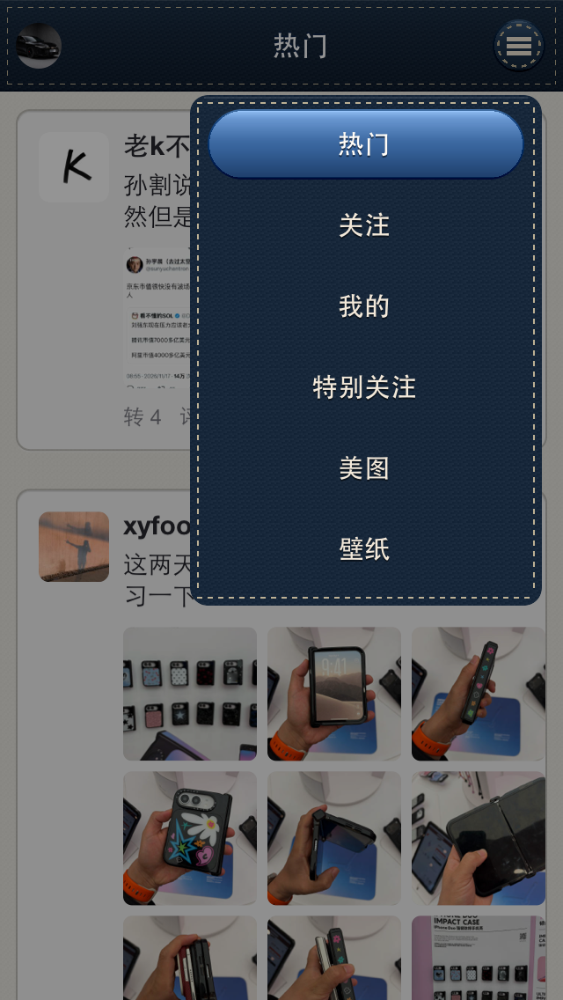
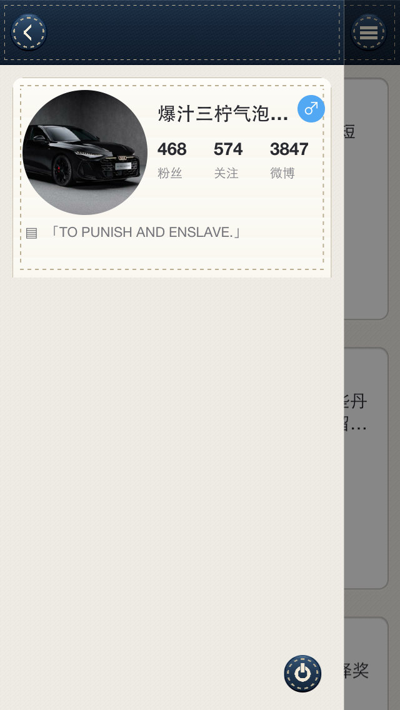

# Legacy 微博 — 越狱 iOS 5/6/7 上的原生微博客户端

一个**不依赖 Xcode、不依赖 Theos** 的 armv7 原生 App：命令行 `clang` 交叉编译、`ld64` 手工链接（跳过 `crt1.o`、自造 `LC_UNIXTHREAD` 入口）、`ldid` 做 ad-hoc 签名，通过 SSH 装进越狱 iPhone 并 `respring` 生效。全部贴图由 Python 脚本逐像素预渲染，仓库里没有任何美术源文件。

业务上是一个可用的微博客户端：多分组信息流、正文 + 热度序评论、图片查看器、扫码登录、账号面板，以及**两套可在运行时切换的拟物皮肤**。

## 截图（真机 iPhone 5 / iOS 6.1.4）

| 主界面 · 汉堡菜单切流（V0.3 皮革皮肤） | 提醒事项皮肤 · 主列表 |
|---|---|
|  |  |

| 账号面板 · 左下切换皮肤 / 右下退出 |
|---|
|  |

## 功能特性

- **信息流**：热门 / 关注 / 我的 / 特别关注 / 服务端自定义分组，右上角汉堡菜单切换，主界面只显示当前所选流；下拉刷新 + 上拉分页。未选过时按登录态定默认（登录=关注、游客=热门），选择持久化到 `weibo_slot.txt`
- **正文与评论**：滑入式正文浮层、`comments/hotflow` 热度序评论（每页 20 条、翻页去重）、二级回复、加载中/空态/失败重试
- **图片**：九宫格缩略图、全屏查看器（左右切换 / 双击缩放 / 捏合 / 拖拽）
- **账号**：扫码登录（app 内二维码 + 桌面轮询脚本）、资料面板、退出登录
- **双皮肤**：账号面板左下阴阳圆钮即时切换 —— **V0.3 皮革**（深蓝缝线导航条 + 亚麻底）与 **iOS 6 提醒事项**（深灰拉丝导航条 + 米白点格纸 + 银灰圆钮），状态持久化到 `weibo_skin.txt`

## 构建

### 前提

- macOS + Apple clang（支持 `-target armv7-apple-ios5.0`）+ 系统 `ld`
- **mini SDK**：构建用的 SDK 桩是一个约 28 KB 的自制目录，位于仓库**上一级**的 `toolchain/mini-sdk`（Makefile 里的 `STUB_ROOT := ../toolchain/mini-sdk`）。它包含 6 个 `.tbd` 桩 + `SDKSettings.plist`，**不随本仓库分发**。若目录不存在，需按 `docs/交付文档.md` 第 3 节重建，或改用完整 SDK：
  ```bash
  scripts/fetch-sdk.sh        # 拉取 theos/sdks 的 iPhoneOS9.3.sdk（网络要求）
  make SDK=full ipa           # 用完整 SDK 构建
  ```
- `ldid`（签名；没有则回退 `codesign -f -s -`）

### 命令

```bash
make                 # 构建 build/Payload/LegacyApp.app（离线，约 3 秒）
make ipa             # 打包 build/LegacyApp.ipa
make verify          # 检查架构 / 最低版本 / 依赖库 / 签名
make clean           # 清理（不会删 Login.txt）
```

编译开关通过环境变量传给 `make` / `scripts/install.sh`（见下方「自检」）。

## 安装到越狱设备

设备需越狱并安装 AppSync（ad-hoc 签名必需），OpenSSH 可连（默认 `root` / `alpine`）。

```bash
THEOS_DEVICE_IP=192.168.8.171 THEOS_DEVICE_PASSWORD=alpine \
  bash scripts/install.sh respring    # 安装并重启 SpringBoard

# 其他模式：launch（安装 + sblaunch 启动）、usb（走 ideviceinstaller）
```

安装后若图标未刷新，再跑一次 `scripts/install.sh respring`。可装机范围是 iOS 5.0+ 的 armv7 设备（iPhone 4S / 5 / 5c / 5s）。

> 登录凭据（`Resources/Login.txt`）已从仓库与包体中排除，不会随代码泄露。

## 自检

项目在没有截图工具的老设备上，用**编译开关 + 离屏渲染**做视觉验证。所有开关都需要 `DIAG=1`，日志写到设备 `/tmp/legacy_boot.txt`：

| 开关 | 验证内容 |
|---|---|
| `SHOTCHECK=1` | 首屏截图 → `/tmp/legacy_shot.png` |
| `GALLERY=1` | 依次截 列表 / 正文评论 / 账号面板 三张 → `/tmp/gallery_*.png` |
| `MENUCHECK=1` | 汉堡菜单端到端：开菜单 → 选流 → 校验 feed / 标题 / 条数 |
| `TABSCHECK=1` | 切流链路：校验标题与当前流一致 |
| `SKINCHECK=1` | 皮肤切换端到端：皮肤值翻转 + 界面重建截图 |
| `FRIENDSCHECK=1` / `COMMENTCHECK=1` | 关注流分页 / 评论翻页 |
| `ACCOUNTCHECK=1` / `LOGOUTCHECK=1` | 账号面板字段 / 退出登录 |
| `SPECIALCHECK=1` / `SPECIALSHOT=1` | 特别关注流 |

例：`DIAG=1 GALLERY=1 ./scripts/install.sh launch`，然后从设备拉取 `/tmp/gallery_*.png`。`diag()` 在非 DIAG 编译下是空语句，正式包不含任何自检代码。

## 技术要点

- **零 Xcode / 零 Theos**：自制 mini SDK + `clang -target armv7-apple-ios5.0` + `ld64 -no_pie -e _main`，链接时跳过 `crt1.o` 并手工造 `__TEXT,__entry` 的 `LC_UNIXTHREAD`
- **自绘 UI**：不用 Storyboard / Auto Layout / ARC；UISegmentedControl、导航栏、按钮、圆角卡片全部自绘，贴图由 `scripts/make_assets.py` 用 Python 标准库逐像素生成 PNG（含两套皮肤）
- **皮肤机制**：所有位图经 `SkinImage()` 按当前皮肤加 `R_` 前缀取名，切换时重建 rootViewController 立即生效；跨重建的端到端自检用文件首字节传递状态（静态变量会被清空）

## 目录结构

```
LegacyApp/
├── Makefile                    # 编译 / 链接 / 打包 / 校验 / DIAG 开关
├── Info.plist                  # bundle id、最低系统 5.0、仅竖屏
├── include/mini/LegacyKit.h    # mini SDK 头（缺 API 时在这里补声明）
├── src/                        # Objective-C 源码（ViewController / Store / Skin / 登录 / 评论等）
├── scripts/
│   ├── make_assets.py          # 逐像素生成全部 PNG（两套皮肤）
│   ├── install.sh              # ssh / usb 装机
│   ├── weibo_login.py          # 桌面侧扫码登录
│   └── fetch-sdk.sh            # 可选：拉完整 iOS 9.3 SDK
├── Resources/                  # 生成物（可重建，不入库）
├── build/ / dist/              # 构建与交付产物
├── docs/交付文档.md            # 完整技术文档（接口 / UI 规范 / 坑与解法 / 验证记录）
└── docs/images/                # 本 README 的截图
```

## 已知限制

- 仅 armv7，不支持 arm64；依赖 m.weibo.cn 非公开接口，字段变更需重新实测
- 凭据以明文存在越狱设备上，仅适合个人设备使用
- 表情显示为文字（如 `[doge]`）；不支持发博 / 点赞 / 转发 / 私信 / 推送
- 视觉验证依赖手工编译开关，不是自动化 CI

更完整的技术细节、接口备忘、踩坑记录和真机验证数据见 **[docs/交付文档.md](docs/交付文档.md)**。
